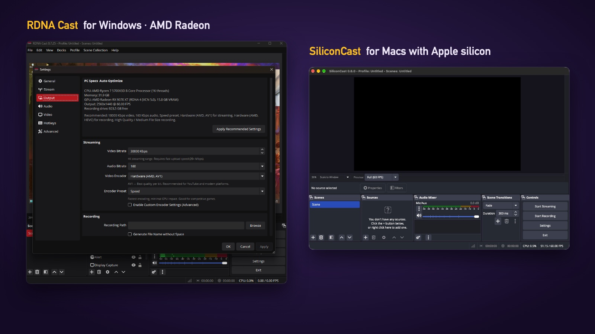
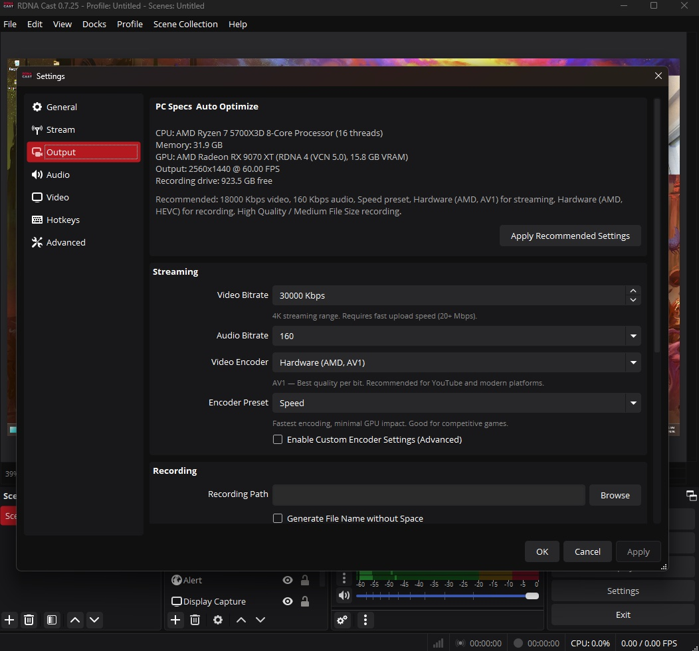

[← All software](https://github.com/gkaragioul/software)

# RDNA Cast and SiliconCast



A lighter version of OBS Studio for recording and streaming your games, with less effect on your frame rate. **RDNA Cast** is the Windows app for AMD Radeon graphics cards, and **SiliconCast** is the Mac app for Apple silicon.

| | |
|---|---|
| **Download** | [⬇️ Windows (RDNA Cast)](https://github.com/gkaragioul/cast/releases/latest/download/RDNA-Cast-windows-setup.exe) · [⬇️ Mac (SiliconCast)](https://github.com/gkaragioul/cast/releases/latest/download/SiliconCast-mac.dmg) |
| **Version** |  · [what's new](https://github.com/gkaragioul/cast/releases) |
| **Runs on** | Windows 10 or 11 (64-bit), with an AMD Radeon card (RX 5000 series or newer) · Macs with Apple silicon (M1 or newer), macOS 13 or newer |
| **Price** | Free |
| **Licence** | GPL-2.0-or-later, like OBS Studio: free to use, change and share |

## What it does

- **Records and streams** to YouTube, Twitch and other services, like OBS Studio, with the same scenes, sources and audio mixer.
- **Uses your graphics card's own encoder:** AMD's on Windows (AV1, HEVC or H.264), Apple's VideoToolbox on the Mac. Your processor stays free for the game.
- **Smaller and lighter:** it keeps only the parts you need for recording and streaming. On Windows that's 11 plugins instead of 36, and it uses far less memory than stock OBS.
- **Draws the preview less often** (the recording still gets every frame), so the game keeps more of your graphics card.
- **Sensible settings from the start:** 1440p at 60 fps, with a bitrate to match.
- **One-click optimizer (Windows):** Settings › Output shows your PC's specs and suggests the best settings. Click **Apply Recommended Settings**.
- **Closes to the tray (Windows):** clicking ✕ keeps it running in the background, and the tray icon has Stream, Record and Save Replay.
- **Fixes for AMD encoding:** steadier bitrate on AV1, smaller bitrate spikes, and no dropped frames when a stream starts.



## Install

### On Windows (RDNA Cast)

1. **Download** the Windows file above.
2. **Double-click `RDNA-Cast-windows-setup.exe`.** If Windows shows **"Windows protected your PC"**, click **More info**, then **Run anyway**. This is normal for apps from small developers.
3. Follow the installer. It replaces any older RDNA Cast and keeps your settings.
4. Open **RDNA Cast** from the Start menu.

### On a Mac (SiliconCast)

1. **Download** the Mac file above.
2. **Open** it, and **drag SiliconCast onto the Applications folder**.
3. **Double-click SiliconCast** in Applications. macOS says it was **"Not Opened"**. This is normal for apps that aren't sold through Apple. Click **Done**.
4. **Allow it once:** open **Apple menu › System Settings › Privacy & Security**, scroll down to **Security**, and next to "SiliconCast was blocked" click **Open Anyway**, then **Open Anyway** again.
5. **Give it permission to record:** SiliconCast opens a **Review App Permissions** window. Allow **Screen & System Audio Recording**, and **Microphone** if you want your voice. macOS may ask you to reopen the app afterwards.

## How to use it

1. The first time it opens, the **Auto-Configuration Wizard** asks whether you want to stream or record, and picks settings for your computer. On Windows, you can also use **Settings › Output › Apply Recommended Settings** at any time.
2. Under **Sources**, click **+** and add what to capture: **Game Capture** or **Display Capture** on Windows, **macOS Screen Capture** on the Mac.
3. To stream, go to **Settings › Stream**, choose your service and sign in or paste your stream key.
4. Click **Start Recording** or **Start Streaming**.

If you've used OBS Studio before, everything works the way you're used to.

## Privacy

- No accounts, no ads and no tracking. It doesn't send anything about you anywhere.
- It only connects to the internet when you stream, or when you sign in to a streaming service.
- It doesn't check for updates by itself. New versions are on the [releases page](https://github.com/gkaragioul/cast/releases), and on Windows **Help › GitHub Releases** opens it.
- Your recordings are saved where you choose in **Settings › Output**. SiliconCast keeps its settings in `~/Library/Application Support/siliconcast`.

## If something goes wrong

- **The recording is black on the Mac:** open **System Settings › Privacy & Security › Screen & System Audio Recording**, turn SiliconCast on, then quit and reopen it.
- **The AMD encoder is missing on Windows:** update your Radeon driver from [amd.com/support](https://www.amd.com/en/support). Without it, RDNA Cast falls back to the x264 encoder, which uses your processor.
- **To report a problem:** [open an issue](https://github.com/gkaragioul/cast/issues), say which app and version you use, and attach the log from **Help › Log Files › Show Log Files**.
- **To uninstall:** on Windows, use **Settings › Apps**. On the Mac, drag SiliconCast to the Bin, and delete `~/Library/Application Support/siliconcast` to remove its settings.

## Build it yourself

Both apps are built from this one source tree.

**Mac** (Xcode and CMake 3.28 or newer):

```bash
./build-siliconcast-macos.sh
```

**Windows** (Visual Studio 2022, CMake and Inno Setup): run `build.bat`. The [Windows build workflow](.github/workflows/windows-release.yml) does the same on GitHub's own build machines.

The Windows build uses the `amd-lite-x64` preset (`OBS_AMD_LITE`) and the Mac build uses `siliconcast-macos` (`OBS_MAC_LITE`). With neither, you get stock OBS Studio 31.0.3.

## Licence and credits

- **Licence:** RDNA Cast and SiliconCast are free software under the GNU General Public License, version 2 or later, the same licence as OBS Studio (see [COPYING](COPYING)). You can use, change and share them. If you share a changed version, share its source code too.
- **Built on [OBS Studio](https://obsproject.com)** 31.0.3, by Hugh Bailey and the OBS contributors. Thank you.
- **Other people's code** in the apps keeps its own licence: see [THIRD_PARTY_LICENSES.md](THIRD_PARTY_LICENSES.md).
- **Names and logos:** "RDNA Cast", "SiliconCast" and their logos are not part of the GPL. See [TRADEMARKS.md](TRADEMARKS.md).
- **History:** see [CHANGELOG.md](CHANGELOG.md).

*Not affiliated with, endorsed by or sponsored by the OBS Project, AMD or Apple. "AMD", "Radeon" and "RDNA" are trademarks of Advanced Micro Devices, Inc. "Apple", "Mac" and "macOS" are trademarks of Apple Inc. Made by [George Karangioules](https://github.com/gkaragioul).*
